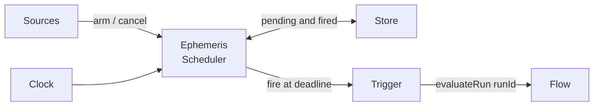

# Concepts

Ephemeris turns time into a trigger for the Kontour suite. It has two
independent parts: a **deadline engine** that wakes Flow when claims expire,
and a **recurring-schedule core** that computes when `cron`, `at`, and `every`
schedules fire. This page explains each building block and how they fit
together. For the domain vocabulary, see [CONTEXT.md](../CONTEXT.md).

## The Kontour layer model

Ephemeris exists because neither Surface nor Flow has a scheduler. Flow only
re-evaluates when something external calls `evaluateRun`, so a claim that
expires at 2am is not noticed until the next evaluation. Ephemeris is the
external actor that notices.

| Layer | Owns |
| --- | --- |
| Hachure | The shape: the TrustBundle and claim schemas, including `expiresAt` and `ttlSeconds`. |
| Surface | The meaning: it derives `fresh` or `stale` from `expiresAt`. |
| Flow | The reaction: it re-derives at the real `now` on `evaluateRun`. |
| Ephemeris | The time: it wakes Flow at deadlines, and evaluates recurring schedules for consumers. |

## Invariants

These hold across the codebase and are covered by tests.

- **It triggers, it never authors.** Ephemeris writes nothing to any
  TrustBundle or ledger. A `Trigger` returns `Promise<void>`, and a
  `FlowRunner`'s result is discarded, so there is no channel for authored state
  to flow back. The only state Ephemeris writes is its own `Store`.
- **Expiry is derived; invalidation is an event.** Ephemeris reacts to the
  freshness fields on a claim. It never synthesizes `stale` or `revoked`
  events. A claim with no freshness field arms nothing.
- **Over-firing is harmless.** A fire only asks Flow to re-derive at the real
  `now`; Surface still decides. This is why coalescing and rate limiting may
  safely drop fires.
- **Deterministic timing.** All deadline-engine timing goes through an
  injectable `Clock`. With `ManualClock` there are no real timers, and firing
  happens synchronously inside `clock.advance()`.

## Deadline engine

The deadline engine is `EphemerisScheduler`. Its loop is: ingest a bundle, arm
a wake-up for each claim deadline, and fire a trigger when the deadline passes.

### How Ephemeris reads Hachure bundles

Ephemeris reads a small slice of a Flow run-output TrustBundle:

- `source`: the bundle's identity. Hachure's trust-bundle schema forbids a
  bundle-level `id`, so Ephemeris keys bundles on `source`. Flow stamps it as
  `flow-run:<definitionId>:<runId>`.
- `claims[]`: each claim's `id`, `expiresAt`, and `ttlSeconds`.
- `runId` (optional, not a Hachure field): the run to fire against. When it is
  absent, Ephemeris takes the text after the last `:` of a `flow-run:` source,
  and otherwise uses the whole `source` string.

Each claim is checked by `validateClaimFreshness` before arming. `id` must be a
non-empty string, `expiresAt` a parseable date-time string, and `ttlSeconds` an
integer of 0 or more. An invalid claim is skipped silently. These constraints
are written into `validateClaimFreshness` by hand; a test checks that the
`claim` schema the `hachure` package publishes still agrees with them.

### Deadlines

A deadline (`ArmedDeadline`) is `{ bundleSource, runId, claimId, fireAt }`.
`fireAt` is derived by `deriveFireAt`:

- If `expiresAt` is present, it wins: `fireAt` is that instant.
- Otherwise, if `ttlSeconds` is present, `fireAt` is the time of arming plus
  `ttlSeconds`.
- Otherwise the claim has no deadline.

A deadline's identity is `(bundleSource, claimId, fireAt)`, available as
`deadlineKey`. Each deadline fires at most once. `arm` skips a deadline that is
already pending or already fired, so re-arming a bundle is safe.

### Coalescing and rate limiting

A claim that keeps changing must not flood Flow. Two mechanisms prevent that,
both keyed per claim on `(bundleSource, claimId)` (`claimKey`):

- **Superseding.** A claim holds at most one pending deadline. Re-arming a
  claim with a different `fireAt` removes its older pending deadline.
- **Minimum fire interval.** With `minFireIntervalMs` above `0`, a due deadline
  for a claim that fired less than that many milliseconds ago is marked fired
  without calling the trigger. `onCoalesced` receives it with the reason
  `"min-interval"`.

A dropped fire is not retried: the deadline counts as fired. The design treats
this as safe because a fire is only a nudge, and Flow re-derives at the real
`now` whenever it is next evaluated.

### Sources

A source feeds bundles to the scheduler's `arm(bundle)` and removals to its
`cancel(bundleSource)`. Sources depend only on that narrow `SchedulerSink`
interface. Any mix can share one scheduler, because `arm` and `cancel` are
idempotent.

- **Programmatic.** Call `scheduler.arm(bundle)` yourself.
- **`DirectoryWatcherSource`.** Watches a directory of `.json` bundle files
  and arms each one on start and on every change. Files that do not parse, or
  that lack a `source` string and a `claims` array, are ignored. It never
  cancels: deleting a file leaves its pending deadlines armed. This is what
  `ephemeris watch` uses.
- **`RegistrySource`.** An in-process registry. A producer that already holds
  a bundle calls `register(bundle)` to arm it and `deregister(source)` to
  cancel it. There is no polling.

A cross-process hosted-ingest source is not implemented yet.

### Stores

The store is Ephemeris's private bookkeeping: pending deadlines, so they
survive a restart, and fired keys, so a restart never fires a deadline twice.
On `start()`, the scheduler re-arms every pending deadline and fires any that
came due while it was down.

- **`InMemoryStore`** keeps state in memory. It is the scheduler's default and
  is meant for tests.
- **`JsonFileStore`** rewrites one JSON file on every change, via a temporary
  file and an atomic rename. It is the daemon's default.
- **`AppendLogStore`** appends one JSON line per change, rebuilds state by
  replaying the log on load, and compacts the log into a single snapshot line
  after `compactThreshold` records (default 1000). A torn final line from a
  crash is skipped. Use it when the number of watched bundles grows.

Fired keys older than `firedRetentionMs` (default 7 days) are pruned on each
sweep, so fired history does not grow without bound.

### Triggers

A `Trigger` is what happens at a deadline. The default, `FlowEvaluateTrigger`,
calls a `FlowRunner` with the deadline's `runId`:

- `programmaticFlowRunner` imports `@kontourai/flow` on first use and calls
  its exported `evaluateRun(runId)`.
- `cliFlowRunner` runs `flow evaluate <runId>` and rejects on a non-zero exit.

A trigger failure is not fatal. It goes to the scheduler's `onError`, which
logs to stderr by default. `NoopTrigger` and `RecordingTrigger` are provided
for tests and examples.

## Recurring-schedule core

The recurring-schedule core answers a different question: given a recurring
schedule, when does it next fire, and how many fires were missed? Station is
its first consumer.

It is a set of pure functions. Time is always a parameter, and the module
reads no wall clock and sets no timers, which a test enforces. It fires
nothing and stores nothing. The consumer owns the executor, persistence, and
the job record.

### Schedule kinds

`Schedule` is a union discriminated by `kind`:

- **`cron`**: a 5-field Vixie-cron expression (`minute hour day-of-month month
  day-of-week`) with an optional IANA `timezone`. Without a timezone it is
  evaluated in UTC. With one, it fires at the local wall-clock time, so the UTC
  offset shifts across daylight-saving changes. When both day-of-month and
  day-of-week are restricted, a day matches if either matches. Only a literal
  `*` counts as unrestricted for that rule; a step such as `0-30/15` does not.
- **`at`**: a one-shot at a fixed epoch instant, `timeMs`. Once that instant
  has passed, it has no next occurrence. `deleteAfterRun` is only a hint to the
  consumer; Ephemeris deletes nothing.
- **`every`**: a fixed interval, `everyMs`. The next fire is the last fire plus
  `everyMs`, so it is anchored to the job's own history rather than the epoch.

### Jobs and catch-up

`ScheduledJob` is the minimal input the functions read: `schedule`,
`lastRunMs` (the last fire, if any), `createdMs`, and `enabled`.

For `cron` and `every`, the catch-up origin is `lastRunMs`, or `createdMs` for
a job that has never run. A job is overdue when its next occurrence after that
origin is at or before now. An `at` job is overdue when it has never run and
its instant has passed, so a one-shot missed while the host was down fires on
the next check. A job with `enabled: false` is never overdue.

When a job has fallen behind, `missedCount` reports how many occurrences were
skipped, so the consumer can decide whether to fire once, fire them all, or
record the gap. The consumer then records the fire in a `RunRecord`, a type
Ephemeris defines but never stores.

## How the parts fit together

The two parts share the package and its invariants, not state. The deadline
engine owns a clock, timers, and a store, and triggers Flow. The schedule core
owns none of these: a consumer calls it with `nowMs`, and fires and persists on
its own. Neither part authors trust state.
